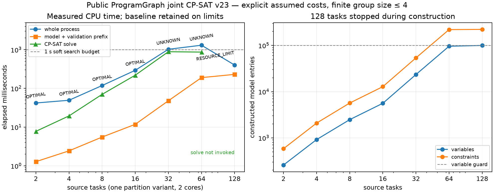

# Public ProgramGraph joint CP-SAT v23: validation and limits

The implemented entry jointly selects partition variants, connected task groups,
local/boundary copies, placement, transfer links and resource/configuration
schedules in one model over the existing source-bound public `ProgramGraph`.
The selected grouping, static payload and transfer set are checked against real
AIR lowering, then final AIE is checked without re-solving. This addresses the
v22 separation between local reuse/tiling composition and fixed-shard scheduling.

The current executable realization is a **static scalar pointwise subset** with
independent axis-zero partitions and explicit host BO communication between
configurations. GEMM, attention, arbitrary reductions, layout search and arbitrary
cross-core SRAM retention are outside this joint path. The accepted hardware
workloads are two source graphs and five implementations, not five model families.
No hardware speedup or calibrated latency optimality is established.

## Frozen evidence

Accepted raw output is `results/taskflow/program-joint-v23/delivery-final`.
`DELIVERY.json` selects the final release inputs/runs and the frozen compiler
`frozen-tools/taskflow-opt-final`; `taskflow-opt-off-final` is the default-off
build. Earlier pilots and failures remain in the same results tree.

Reviewable records are in [the evidence directory](../evidence/program-joint-v23/).
`compiler-source.json` records exact compiler-source and binary SHA-256 identities;
`raw-manifest.json` records the accepted generated IR, ELF, full numeric arrays and
runtime logs. Inputs, chosen/baseline public graphs, child realization records,
final-AIE receipts, numerical checks, toolchain versions and scaling traces are
versioned there. The complete raw arrays/builds stay in the results tree.

The new Core implementation is documented in
[the compiler interface](https://github.com/guosran/orbit/blob/main/docs/taskflow-program-joint-v23.md).
Core release commit: [7bb01b2](https://github.com/guosran/orbit/commit/7bb01b2982683d0057f3f82980f8850c45e4fc29).

## Correctness and independent checking

- Core regression: **44/44**. Combined Core/AIR/original-driver regression: **61/61**.
- Public source-bound joint contracts: **23/23 with OR-Tools**, **23/23 without it**.
  The default-off result is `UNAVAILABLE` with an independently checked baseline;
  `ldd` has no OR-Tools dependency.
- Three final-AIE contract sets pass **39 cases**: three valid implementations
  plus 36 deliberate corruptions. They cover target/core coordinates, arithmetic,
  BD offsets, DMA start/await/free, caller ABI order, cross-owner flow,
  configuration duplication/reordering and extra execution entries.
- Five selected implementations compile and pass actual AIE checking. Two fresh
  processes per implementation, each with two warmups and six hot calls, pass
  **80 calls, 128 complete output arrays and 256 FP32/FP64 reference checks**.
  Maximum absolute error is **1.1920928955078125e-7** against either reference.
  All calls retain `atol=rtol=1e-5` and check complete finite outputs.

The independent tiny oracle enumerates grouping, placements and all unary-resource
orders for actual source `A(X)→Y, B(X)→Z`. At 4 bytes/value, compute 4 ns/task,
input DMA 8 ns and output DMA 1 ns, the optima are:

| Target change | Model optimum | Selected structure |
|---|---:|---|
| 8-byte SRAM, shared DMA | 21 | split |
| 12-byte SRAM, shared DMA | 18 | fuse/share X |
| 12-byte SRAM, independent DMA | 13 | split/parallel |

The same effect survives hierarchical shared-resource demands. A separate common
shared-memory case forces two configurations and an optimum of 26. A forged
13-unit overlapping shared-DMA schedule is rejected by independent exact integer
calendars before stored-graph comparison. Other contracts reject omitted coverage,
wrong versions/routes/costs, altered source/target identity and forged public graphs.
A real RAW edge forces later-configuration consumption of the produced version.

## Actual NPU programs

The shared-input graph is FP32 `Y=X+1, Z=X*2` on `1×8` arrays. Hardware-model
capacities are 64/96 payload bytes, with the tiny oracle's bandwidth scaled to
retain the explicit synthetic duration ratios. The chain is FP32
`T=I+1; R=T*2` on `17×64` arrays. Both are cloned from actual source bodies;
no kernel recipe or host arithmetic implements their outputs.

| Implementation | Chosen row chunk | Groups | Configurations | Assumed model ns | Two process medians, ms |
|---|---:|---:|---:|---:|---|
| chain-cross-config | 17 | 2 | 2 | 9136 | 0.6088 / 0.8855 |
| chain-tiled | 9 | 2 | 1 | 4288 | 0.4981 / 0.9092 |
| shared-capacity-split | 1 | 2 | 1 | 21 | 0.5272 / 0.9076 |
| shared-fused | 1 | 1 | 1 | 18 | 0.3938 / 0.4329 |
| shared-parallel | 1 | 2 | 1 | 13 | 0.6365 / 0.3891 |

The chain with limited SRAM exports/imports its real host temporary between two
configurations. The tiled chain chooses 9-row chunks from 5/9/17 candidates,
including the 8-row tail, and runs two physical cores in one configuration.

Host medians include existing runner staging/synchronization, submit/wait,
wait-checkpoint serialization and output readback. They are descriptive samples,
not a paired performance experiment. Synthetic model nanoseconds are uncalibrated
cost units; the model's 21/18/13 order is not a demonstrated hardware speedup order.
In particular, shared DMA/bandwidth assumptions do not certify a timestamped
physical schedule. Runtime realizes selected groups, coordinates, copies and
ordered configurations with readiness/arbitration, rather than timed dispatch.

The installed AIR channel conversion failed when two configurations sharing a
host temporary were put in one launch (`failed to get S2MM tile for L3 allocation`).
The failed AIR and compiler log are preserved under `evidence/.../failures/`.
The accepted lowering uses a separate synchronous launch per configuration and
passes final-AIE correspondence and actual numerical execution.

## Does solve time grow badly?

**Yes: the fully coupled model becomes expensive at modest sizes.** All 16 final
CPU runs are serialized after builds and hardware trials. They vary 2–128 source
tasks, 1/2/4 compute resources and one/three partition variants. All returned a
checked baseline or a checked optimal plan; no external watchdog fired.

The primary chain uses one partition variant, two compute resources, connected
local groups of at most four tasks and a 1-second soft solver/search quota:

| Tasks | Local groups | Variables constructed | Constraints constructed | Model/prefix ms | Solve ms | Whole process ms | Status |
|---:|---:|---:|---:|---:|---:|---:|---|
| 2 | 3 | 258 | 582 | 1.3 | 7.8 | 42.0 | OPTIMAL |
| 4 | 10 | 917 | 2,087 | 2.4 | 19.5 | 49.3 | OPTIMAL |
| 8 | 26 | 2,477 | 5,667 | 5.5 | 70.1 | 118.5 | OPTIMAL |
| 16 | 58 | 5,597 | 12,827 | 11.8 | 219.1 | 293.2 | OPTIMAL |
| 32 | 122 | 23,485 | 53,827 | 47.8 | 885.8 | 1023.4 | UNKNOWN |
| 64 | 250 | 96,125 | 220,307 | 189.8 | 866.4 | 1303.8 | UNKNOWN |
| 128 | 506 | 100,001 | 222,485 | 230.0 | 0.0 | 400.8 | RESOURCE_LIMIT |

32 and 64 tasks return `UNKNOWN` with the saved baseline. 128 stops at the
100,000-variable guard (100,001 observed at the checkpoint), so its solver is
**not invoked**; the counts are a partially constructed model, not its full size.
The 64-task case reaches about 387.3 MiB process high-water RSS.
RSS is `getrusage` process telemetry including startup/platform effects, not
isolated solver allocations; it must not be used to infer per-variable memory.

Four resources already return `UNKNOWN` at 16 tasks. Three partition variants
return `UNKNOWN` at eight tasks with a 0.5-second quota. Thus the fast small
single-variant cases do not establish that joint solving scales well. The domain
is fully enumerated only within its stated group/instance/variant bounds;
`domain_complete=true` does not include larger groups or unrestricted programs.

The assignment expansion is group × placement × configuration, with optional
compute/transfer intervals and resource closures. For these chains, group count
and configuration bound both increase with task count, producing roughly
quadratic model growth before any harder search. `UNKNOWN` has no incumbent/bound
proof from CP-SAT; zero placeholder bound/gap fields are not zero-gap certificates
when `has_objective=false`. A checked baseline is retained separately.

The 1-second quota is **soft**: 64 tasks take about 1.30 s in the whole process.
Discovery, validation, solver shutdown and serialization are not fully preemptive.
Each scaling worker has an external deadline of at least ten seconds. The CLI
publishes the checked baseline before CP-SAT; the script records `external_timeout`
if a process exceeds its watchdog. Bounded fallback is established here;
large-instance optimality and unrestricted scaling are not.



## Reproduction

Build separate default-off and OR-Tools/AIR-on compiler directories using the
pinned v22 LLVM/MLIR and OR-Tools v9.15.6755 SDK recipe. Run compiler-only checks:

```sh
cmake --build ON_BUILD --target check-taskflow-program-joint
cmake --build OFF_BUILD --target check-taskflow-program-joint
python3 orbit/test/run_core_regressions.py --tool OFF_BUILD/tools/taskflow-opt/taskflow-opt --output NEW_CORE_LOGS
```

Source the installed AIE environment before using the existing AIR/ELF helper:

```sh
source /path/to/aie-toy/scripts/env.sh
python taskflow/scripts/run_program_joint_v23.py \
  --compiler ON_BUILD/tools/taskflow-opt/taskflow-opt --output NEW_OUTPUT --execute
```

`--execute` is opt-in. Its worker processes are main-agent-only, serialized by
`/tmp/npu.lock`, each with a 60-second timeout. Omit it to compile and check without
NPU submission. All output directories must be new. Numeric source fixtures,
FP32/FP64 reference arrays, complete outputs and compiler/runtime failures remain
saved; no tolerance changes or arithmetic fallback are applied.

After builds and hardware work stop, collect scaling separately:

```sh
python3 taskflow/scripts/program_joint_scaling_v23.py \
  --compiler ON_BUILD/tools/taskflow-opt/taskflow-opt --output NEW_SCALING --seconds 1
# Add --cores 1 or --cores 4; use --sizes 2,4,8 --chunks 2,4,8 --seconds 0.5
# for the three-partition-variant campaign.
python taskflow/scripts/plot_program_joint_v23.py \
  --scaling NEW_SCALING/scaling.json --output NEW_SCALING/scaling
```

For the 39 final-AIE positive/corruption cases, invoke the compiler's
`test/TaskflowGeneric/program_joint_aie_v23.py` with `--compiler`, `--source`,
`--target`, `--solution` and `--aie` for shared-parallel, chain-cross-config and
chain-tiled outputs. It never re-solves frozen choices.
