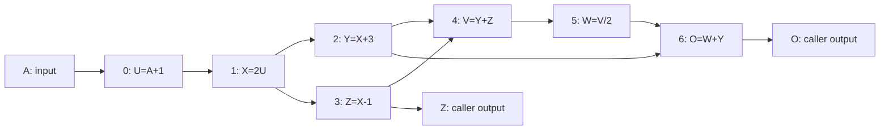
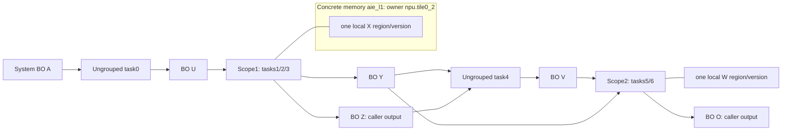
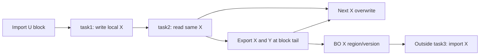
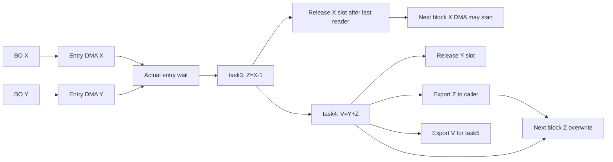

> Publication snapshot of `results/taskflow/subgraph-execution-v19/CONCRETE-PLAN.md`. Experiment paths below are relative to that ignored local result directory. Frozen reports, raw observations, compiled artifacts and failures remain unchanged locally. See [results](taskflow-subgraph-execution-v19.md), [example](taskflow-subgraph-v19-example.md), and [reproduction](taskflow-subgraph-v19-reproduce.md).

# A complete program, two scope choices and actual execution

The source is `test/TaskflowAIR/fixtures/subgraphs-v19.mlir` in ORBIT. It contains actual FP32 scalar arithmetic, seven Taskflow task bodies and eight17×136 arrays. Z and O are caller outputs. The independent five-task fixture omits V/W and returns Y+Z instead. Both execute with original precision/tolerance.

Each full array is9248 bytes. The entire program payload is73984 bytes, while a three-array full group needs27744 bytes and a four-array group36992: all exceed the unchanged24576-byte local payload budget. Four-row blocks need2176 bytes per array; the largest chosen group has four simultaneous blocks,8704 bytes. A one-row tail executes the remaining row. Eight-row blocks also execute correctly at17408-byte peak. Twelve-row four-buffer retention needs26112 and is rejected, rather than increasing the budget or keeping the whole program locally.

## The original search changes the graph

The final original C++ search (`estimated-search-r3`) starts at four-row materialization. It discovers producer/consumer intervals from access/version facts, compares different scopes and selects parents by assumed cost. Its second round chooses source466264… through these actual archived actions:

1. `mapping_residency_tasks_1_2_3_data_4`: retain X for the two consumers Y and Z.
2. `mapping_residency_tasks_1_2_3_data_4_tasks_5_6_data_7`: additionally retain W for O.

The first-round parents are the X scope and the W scope. The second action is materialized from a score-selected parent, not manufactured by a runner. The retained data indices refer to analyzed source storages and are not hardcoded in discovery. Tiling composes through separate source actions. The full29-source archive and final29×7 parameter sensitivity are retained.

The architecture's actual owner ID is `npu.tile(0,2)`; it is referenced by the target resources/memory, not constructed by a public planner. The diagram shortens its label only for Mermaid syntax. Both local scopes use the same concrete tile in different explicitly serialized configurations. Separate group semantic dependencies describe source consumption; implementationDependencies describes the chosen single-tile configure/run sequence. The dependency graph does not pretend this configuration serialization is a source semantic chain.

The final configuration count is8: task0×2 shapes, scope1×2 shapes, task4×2 shapes and scope2×2 shapes. Materialization uses7×2=14 configurations, already a shape-batched reasonable baseline. It does not intentionally recreate the old48-configuration path. Requested transfer payload falls147968→101728 bytes; this is static descriptor/region coverage, not measured DDR traffic.

## A partial scope preserves its boundary

The separate `mixed_boundary` source2489cd… selects only tasks1/2. X is consumed by task2 inside the scope and task3 outside it. Its host allocation and necessary export remain. One local X region/version serves the internal reader and export; task3 later imports the corresponding host version.

In the final compiled public ledger, the first4×136 X local copy is copy21/allocation13, created by compute16. Its users are compute17 (task2) and transfer18 (X export). The next X overwrite compute21 depends on both17 and18. A previous validity ordinal is not substituted for either completion. Allocation13 is explicitly `reusable-slot` at `aie_l1`, spatial owner `npu.tile(0,2)`.

Y also has multiple consumers in different groups. Its host copy/version remains valid for the two explicit imports; there is no unsupported promise to preserve SRAM across configuration replacement. Pure internal V in the `internal_only` comparison has no host allocation or transfers, whereas V is deliberately materialized in the final W-retaining composition.

## The output-role scope catches a real implementation defect

`output_role_boundary`, source0820d7…, selects tasks3/4 and retains Z. Z must serve task4 locally and still be returned to the caller. V is exported for task5. The plan therefore imports X/Y and exports Z/V, with two incoming and two outgoing streams.

Initial AIR imported Y only near task4, even though the public first compute waited for it. The actual checker rejected that topology. Real upfront DMA/wait now implements both entry prerequisites. It then observed that X is free after task3, while Y remains live until task4. The explicit `last-reader` input-release implementation records those different refill prerequisites in the public event graph before cost. Outputs still wait for their internal last reader and export before reuse. The same checker continues to reject the old late-Y artifact. These two failures are preserved; no fake arithmetic/read was added to hold X artificially.

AIR expands the plan into local buffers, source-bound scalar loops, rectangular DMA and tokens. The installed AIR→AIE compiler produces concrete shim allocation/flow/channel/core DMA/lock/runtime BD operations. The C++ checker follows actual host ABI→BD→shim/channel/flow→local buffer routing, exact element coverage and real core lock placement. It compares arithmetic value DAGs and addresses with source operations and checks required/actual causal closures. Identity attributes alone cannot pass these checks.

## Why the model chooses this result, and what hardware supports

The unchanged assumed model charges scalar work and local accesses per task instance, transfer startup plus payload service,40µs per configuration and a200µs total prepared-call host envelope. ProgramTiming schedules those activities on the declared compute/DMA resources and buffer lifetimes.

The baseline predicts1.098312ms. Six removed configuration charges contribute240µs, reduced requested payload46.240µs and25 removed delivery starts12.500µs. The W group additionally permits8.028µs of predicted prefetch after V's last reader, so the final prediction is0.791544ms. The alternate V-retaining two-group plan has equal bytes/configurations but predicts0.799572ms. This is a schedule-model distinction; physical8µs overlap and the W-versus-V preference have not been measured reliably.

Every final plan's complete source, graph, native plan and actual AIR are equal to the checked search artifacts, with final Core/AIR receipts and actual-AIE contract checks. Two final NPU sessions execute all8 plans correctly:528 calls/1056 full arrays. Relative to its baseline, the final composition has paired median−280.853µs and−244.364µs, both resolved under the frozen descriptive bootstrap rule. Expanded pairwise ranking supports10/16 then15/16; small differences and one wrong ordering remain. Actual correctness, successful score-driven search and this coarse measured benefit do not establish general fine ranking.

The full assumed Gantt is `visualizations-r2/assumed-schedules.svg`, with exact schedule JSON and copy-lifetime CSVs. The timeline is an estimate, not device timestamps; CSV validity ordinals are not completion times. Raw performance/output evidence is in `npu-final-session-r1`, `npu-final-session-r2`, and `observation-final-audit-r1/report.json`.
